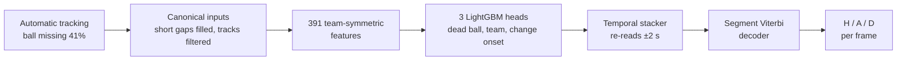

# Football possession from tracking data, built in one night with a team of AI agents

**62nd of 759 submissions (top 9%)** in the Initial Challenge of More Than A Hack 2027, organised
by Metrica Sports, FC Barcelona and Mobile World Capital Barcelona. Entered as team **Montreal**.

Built by one person, [Ibrahim El Makhtoum](https://github.com/ibra049), in one night, by
directing six parallel Claude Code sessions: 250 commits, about 12,900 lines of Python and 221
tests, with the submission locked 8.5 hours after the first commit. How that worked is in
[docs/WORKFLOW.md](docs/WORKFLOW.md).

## The task

For every frame of FC Barcelona vs Athletic Club, say who has the ball: `H` (Barcelona), `A`
(Athletic) or `D` (dead ball). The input is automatic tracking data in which the ball is missing
on 41% of the graded frames and 22 players appear as 46 anonymous track slots. No labels from
the match could be used, and the organisers forbade uploading its data to AI services.

## Results

Entries were ranked on spellF1, which matches whole possessions one to one.

| | spellF1 |
|---|---|
| **This pipeline on the competition match** (official scoreboard, 20 Nov 2026) | **0.614** |
| Organisers' baseline on the same match | 0.243 |
| Top-20 cutoff / first place | 0.652 / 0.710 |
| This pipeline on two held-out Bundesliga matches with simulated tracking noise | 0.726 |
| Organisers' baseline on the same held-out matches | 0.261 |

The top 20 advanced to the next phase. This entry finished 0.038 below the cutoff.

## How it works



- **Training without target labels.** The models learn from 7 open Bundesliga matches, degraded
  by a noise simulator so that clean tracking looks like the automatic tracking.
- **Label-free transfer checks.** Audits compare the provided tracking with the training data
  without reading any ground truth. They can only refuse a candidate, and they refused two that
  scored higher on external data.
- **Reproducible.** One command regenerates the submitted file byte for byte.

The full method, results and limitations are in [docs/Montreal.md](docs/Montreal.md), the
technical document as submitted.

## How it was built

A captain session owned the interface contract, merged the work and decided what shipped. Four
lane sessions (target I/O, external data, model, decoder) worked in separate git worktrees, each
from a written work order. A watchdog session resumed them after pauses. A hook kept the
competition data out of every agent's context. A valid fallback submission existed 42 minutes
after the first commit, and a model beating the official baseline after 69 minutes.

The setup, the timeline of the night, the decisions the agents made without me and what went
wrong are in [docs/WORKFLOW.md](docs/WORKFLOW.md). The work orders are in [prompts/](prompts).

The repository as submitted on 17 November 2026 is tagged `submission-2026-11-17`. Later commits
add this description and the work orders; the pipeline is unchanged.

## What is in this repository

This repository holds **code only**:
- No competition data.
- No frame-level output derived from it.
- No external dataset.

Licences and data sources are in [LICENSE](LICENSE) and [ATTRIBUTION.md](ATTRIBUTION.md).

## Install

Python **3.12** (macOS or Linux). Every dependency is pinned in `requirements.lock.txt`.

```bash
python3.12 -m venv .venv
.venv/bin/pip install -r requirements.lock.txt
.venv/bin/pip install -e . --no-deps
```

## Where the data bundle goes

Unpack the official bundle anywhere, keeping its file names. Only the tactical source is read:

```
<bundle>/
└─ tactical/
   ├─ BAR-ATH_tactical_atd.xml            tracking metadata (FIFA/EPTS)
   ├─ BAR-ATH_tactical_atd.txt            tracking, players and ball
   └─ BAR-ATH_tactical_smart_tagging.xml  Smart Tagging (SportsCode XML)
```

The video, the broadcast recording and the homography are not used.

## Regenerate the submission (single command)

```bash
MTAH_DATA=<bundle> PYTHONPATH=src .venv/bin/python -m mtah.predict --config configs/final.json
```

This writes `<bundle>/out/Montreal.csv` (or pass `--data-dir <bundle> --out <file>`). It prints one
status line with `valid=1` from the official `validate_submission`, and the file's SHA-256. The
output is deterministic: the same bundle and repository give the same bytes. Expected:

<!-- updated by the captain at each candidate, together with configs/final.json -->
```
EXPECTED_SHA256  ddd68c49e02c012d01f10896c24dc1fa55005fe0c898194e065b5af4decc3bed   configs/final.json = candidate v4p (lgb_v4 + stacker on its probabilities and onset + frozen decoder); configs/v1q.json gives a97c88ec23a6cd92ea86133e80e56b87dbeeafd4efed9e28804386e3afb918ab; configs/v1.json gives 31839e5696ba1f6f1349abd711ba0176aa7a61be4fb8ed13f9dc32725ae1f4a1; fallback configs/fallback_baseline.json gives 678aa2d4bae99a79b478e6275257b3cbac464d55bcdc778eabf9dea1f05c84da
```

## Run the tests

```bash
PYTHONPATH=src .venv/bin/python -m pytest -q tests
```

The tests use synthetic fixtures (with edge cases such as missing ball, empty slots and malformed
tokens) and need no data. Tests that need the Metrica sample data skip when it is absent. Tests
that compare against the organisers' starter code skip unless their repository is checked out
at `vendor/challenge/`.

## Retrain on external data

Training and tuning use **only** the open IDSSE matches (DFL/Sportec, CC BY 4.0) and the Metrica
sample games. Nothing from the provided match is used. Put the downloaded IDSSE files in
`~/mtah-external/idsse/`. The retraining scripts read caches and predictions under
`~/mtah-external/` (only the parsers also accept `MTAH_EXTERNAL`). Regenerating the submission
needs none of this. Then:

```bash
export PYTHONPATH=src
# 1. parse IDSSE into canonical sequences and build the fixed degraded caches
#    (all profiles in configs/degrade.json, seeds 0 and 1)
.venv/bin/python scripts/build_degraded_cache.py --seeds 0 1
# 2. frame model: leave-one-match-out out-of-fold predictions and the all-5-match model in
#    models/<name>/. configs/model.json holds the settings of the last model trained; the shipped
#    models/lgb_v4 records its own settings and training draws in meta.json
.venv/bin/python scripts/model_lomo.py --name <name>
# 3. temporal stacker on the frame model's out-of-fold outputs (docs/stacker.md); shipped:
#    models/stack_lgb_v4p on lgb_v4
.venv/bin/python scripts/stack_oof.py --base <name> --name <name>p --metrica --holdout --save models/stack_<name>p
.venv/bin/python scripts/stack_check.py --artefact models/stack_<name>p --name <name>p
# 4. decode the out-of-fold predictions with the frozen decoder and score them with the official
#    metric (team selection table)
.venv/bin/python scripts/decoder_bench.py export --model <name>p --cfg configs/decoder.json --name <labels>
.venv/bin/python scripts/eval_external.py --pred-root ~/mtah-external/labels/<labels>
```

`scripts/decoder_bench.py grid --model <name>` reruns the decoder's coarse grid (minimax regret
over the label views, centre of the plateau).

## Checks used during development

```bash
PYTHONPATH=src .venv/bin/python -m mtah.check_target <bundle>       # parse assertions vs. published aggregates
PYTHONPATH=src .venv/bin/python -m mtah.check_candidate --data-dir <bundle> --csv <file>
.venv/bin/python scripts/release_check.py --config configs/final.json
```

- `check_target` compares the parsed data with aggregates published in the organisers' `DATA.md`:
  frame count, ball visibility, tag counts and kickoff tags.
- `check_candidate` summarises a submission without any ground truth: label shares, possession
  lengths, and agreement with Smart Tagging.
- `release_check` predicts, validates and reruns for the same SHA-256, then regenerates from a
  clean clone of `main`.

During development, all three ran against the match data only through `scripts/run_target.sh`,
which keeps full output private and prints aggregate status lines only (see the technical
document, "Rule compliance").

## Layout

- `src/mtah/`: the package; interfaces in [CONTRACT.md](CONTRACT.md).
  - `io_target`, `io_idsse`: parsers.
  - `relabel`: label definition.
  - `degrade`: synthetic automatic-tracking noise.
  - `baseline`: the organisers' reference method.
  - `submit`, `predict`: writing the file.
- `configs/`: every setting used to produce a file.
- `scripts/`: external-data pipelines, evaluation and release checks.
- `docs/`: technical document, evidence notes, and how the project was built (`WORKFLOW.md`).
- `prompts/`: the work orders given to the agent sessions.
- `CLAUDE.md`, `.claude/hooks/`: the rules every session read and the data guard.
- `third_party/mtah_challenge/`: unmodified official `possession_metrics.py` and `games.py` (MIT).
