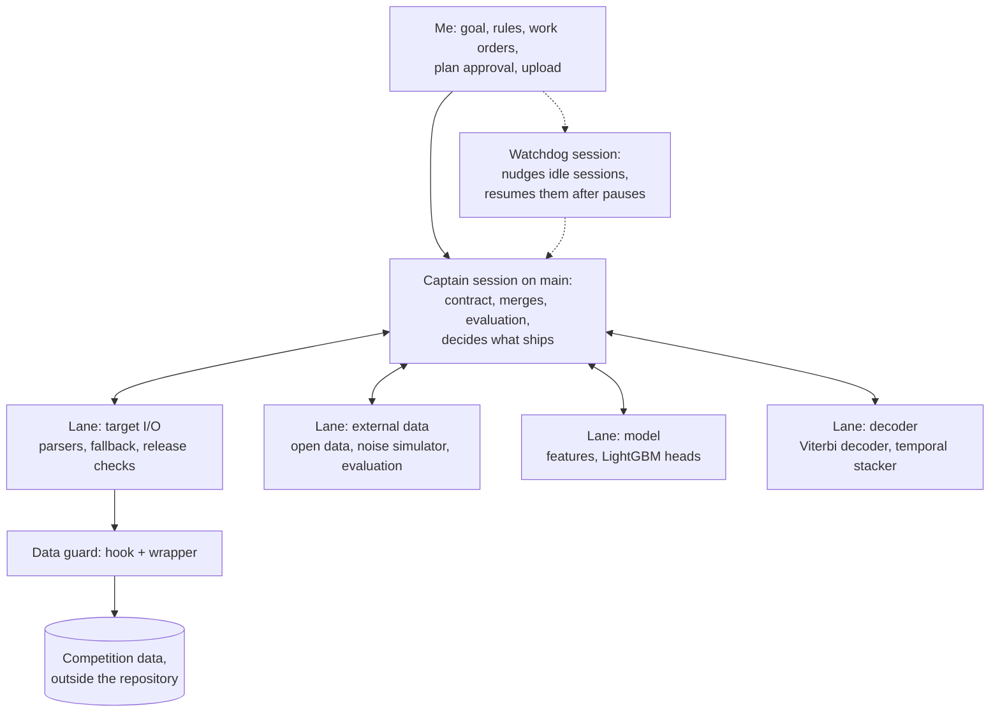

# How this was built: one person, one night, a team of AI agents

Everything in this repository was built between 01:53 and 10:28 EST on 17 November 2026, the day
of the deadline. I worked alone. The code, the experiments and the technical document were
written by [Claude Code](https://claude.com/claude-code) agents running in parallel, under rules,
an interface contract and work orders set up before I went to sleep.

This page describes the setup, what happened during the night, and what I would reuse.
The method itself is in [Montreal.md](Montreal.md).

## In numbers

| | |
|---|---|
| First commit to a valid fallback submission | 42 minutes (01:53 to 02:35) |
| First commit to a model beating the official baseline | 69 minutes (spellF1 0.647 against 0.217 on external matches) |
| First commit to the locked submission | 8 h 35 min, about 3.5 h of it paused on usage limits |
| Commits and merges | 250 commits, 95 merges into `main` |
| Code | about 12,900 lines of Python, 221 tests |
| Candidates | 6 frame models and 8 stackers trained; 4 promoted in turn; 5 refused |
| Result | 62nd of 759 submissions; spellF1 0.614 on the real match (official baseline 0.243, top-20 cutoff 0.652) |

## The setup

Six Claude Code sessions ran at once: a captain, four lanes and a watchdog. Each piece below is a
file in this repository.

| Piece | File | What it does |
|---|---|---|
| Rules | [`CLAUDE.md`](../CLAUDE.md) | Read by every session. The data rule, the train/dev/holdout split by match, "every component must beat the simpler version or it is dropped", determinism, and the limits of the machine (Apple M1, 8 GB RAM). |
| Interface contract | [`CONTRACT.md`](../CONTRACT.md) | The shared data structures and function signatures. Only the captain may change it. It is what lets four sessions write code in parallel that still fits together at merge time. |
| Work orders | [`prompts/`](../prompts) | One per session: the captain, the four lanes and the release. Each says what to build, how to prove it, and who to report to. |
| Isolation | git worktrees | One branch and one working copy per lane. The captain merges into `main` and runs the shared tests after every merge. |
| Data guard | [`.claude/hooks/guard_target_data.py`](../.claude/hooks/guard_target_data.py), [`scripts/run_target.sh`](../scripts/run_target.sh) | Keeps the competition data out of the agents' context (below). |
| Adoption rule | [`Montreal.md`](Montreal.md), Section 8 | A component is adopted only with a paired gain of at least +0.01 while losing on at most one of five matches. Two holdout matches are scored once, after the lock. |

### The overnight protocol

Every lane's work order ends with the same block. It is what kept the work moving while nobody
was there to answer:

> OVERNIGHT RULES (Ibrahim asleep until ~08:00 EST):
> - Never wait on him. Put questions in `coord/QUESTIONS.md` with the default you assumed, then continue.
> - After each milestone, append one line to `coord/STATUS.md`.
> - The captain is the Claude session running in the main checkout. […] Report commit IDs and results via SendMessage. When your work order is done, ask it for the next task instead of stopping.
> - Avoid actions that need permission approval (git push, new installs); they hang overnight. Local commits are fine.

The status log and the questions file are local and are not published here. The quotes on this
page come from them.

### The data guard

The organisers forbade uploading the provided match data to AI services. Agents were writing and
debugging the code that reads that data, so the rule had to be enforced by a tool, not by
remembering it:

- The data lives outside the repository.
- A hook runs before every tool call and blocks anything that touches the data directory or its
  file names.
- Code runs on the data only through `scripts/run_target.sh`. It keeps the full output in a
  private log and relays only whitelisted `SAFE| key=value` lines: counts, flags, hashes,
  runtimes. On a crash it shows where the error was raised and redacts the message.
- The parsers were written from the public documentation and tested on synthetic fixtures and
  on an open sample game in the same format. They were then proven on the real data by assertion:
  the port of the organisers' baseline reproduces their four published files byte for byte.

One consequence: no agent ever looked at the match. Every decision about it was made from
aggregate, label-free checks (Section 9 of the technical document).

## The night, hour by hour (EST)

| Time | What happened |
|---|---|
| 01:53 | First commit: rules, contract, data guard, work orders. Lanes start in their worktrees. |
| 02:17 | External-data lane reports: Bundesliga parser, label audit, noise simulator, evaluation code. |
| 02:30 | I approve the captain's plan and answer its questions. After 02:35 the work does not wait on me. |
| 02:35 | A valid submission exists: our code reproduces the organisers' baseline byte for byte. |
| 02:36 | Decoder v1 (segment Viterbi) with 66 tests. |
| 02:57 | First frame model: three LightGBM heads on 223 features. |
| 03:02 | Candidate v1 passes the adoption rule: 0.647 against 0.217 for the baseline, better on 5 of 5 matches. |
| 03:05 | Usage limit: every session pauses, after writing its state to the log. |
| 04:01 | The limit resets and the watchdog resumes all five working sessions. |
| 04:23 | v1 becomes the file to upload. The captain catches a lane commit that changed existing feature columns, so stored predictions no longer reproduced; it pins the code and requires a bit-exact regression test for every model before merging that lane again. |
| 04:36 | v2 is refused although it scores +0.032 on external data: on the provided tracking, 8 of its feature medians fall outside the range seen in training. |
| 04:53 | v3 is refused: it over-calls dead ball on the provided tracking. |
| 04:58 | The ball audit finds the cause: the provided ball track is low-pass filtered, so the touch detector fires about once a minute instead of 20 to 35 times. The inputs are redesigned (v4). |
| 05:15 | iCloud evicts 483 project files and git hangs in several sessions. Cleared at 05:33. |
| 05:50 | v1p (a stacker that uses the change-onset signal) is refused: that signal is nearly silent on the provided tracking. |
| 06:04 | v1q becomes the file to upload. |
| 06:31 | Usage limit again. Model training keeps running unattended. |
| 09:00 | Sessions resume. |
| 09:18 | v4p becomes the file to upload. |
| 10:11 | Before looking at the last contender's output on the match, the captain writes down the rule it must pass. |
| 10:21 | The last contender is refused: its gain came from a property of the sample data that the real tracking does not have. v4p is locked. |
| 10:28 | The two holdout matches are scored, once: 0.726 against 0.261 for the baseline. Release checks pass from a clean clone. |
| 12:01 | Final release commit. I then push, make the repository public and upload the file. |

Commits per hour, from `git log`: 02h 74, 03h 10, 04h 56, 05h 40, 06h 11, 09h 24, 10h 33, plus
one at 01:53 and one at 12:01. The gaps are the two pauses.

## Decisions made without me

The useful part of the night was not the speed of typing. It was that the system refused its own
best-scoring models when the evidence said they would not transfer. Three entries from the
status log, trimmed:

> [03:02] [captain] G3 PASSED: candidate v1 […] on the team table, 5 matches OOF: nominal family 0.6469 […] Reference smooth50: 0.2165 nominal. Paired gain +0.405, 5/5 matches -> ADOPT.

> [04:36] [captain] DECISION: v2 NOT promoted; upload file stays v1 […]. Reason: drift report of lgb_v2 on target: 8 feature medians outside the reference 5-95% band (v1: 0); touch-timing features […] +3.7 IQR vs stoppage reference (touches far sparser on target than in jittered training data).

> [10:11] [captain] PRE-REGISTERED RULE for the final choice (written before any target readout of v4m): ship v4mp instead of v4p only if ALL hold: […]

Two more, from the same log:

- At 04:30 the plan called for a pass/fail check against the public five minutes of ground
  truth. The permission system blocked the request. The captain stopped, did not work around it,
  and left me a question with the default "not run". It was never run.
- At 05:31, with git frozen by the iCloud eviction, the captain tried to restart the sync
  daemon and was denied. It left system processes alone, wrote down three fixes for me, and
  pointed the lanes to a copy of the release outside the synced folder.

## What went wrong

- **Usage limits** stopped every session twice, for about 3.5 hours in total. What saved the
  night: each session logged its exact state before pausing, long training jobs kept running,
  and the watchdog sent resume messages when the limit reset.
- **The repository was in an iCloud-synced folder on a nearly full disk.** Evicted files made
  reads and git hang twice. The fix during the night was a loop that kept the files downloaded,
  and moving the virtual environment out of the folder. The real fix is not to put a working
  repository in a synced folder.
- **8 GB of RAM.** Swap reached 9.2 of 10.2 GB with six sessions and model training running.
  Jobs that take seconds stalled for minutes.
- **The external score was optimistic.** The pipeline scored 0.726 on held-out Bundesliga
  matches with simulated noise and 0.614 on the real match. The transfer checks kept the worst
  failures out, but they could not measure the remaining gap.

## Who did what

**Me.** I set the goal and the constraints, decided to split the work into four lanes behind one
contract, and wrote the rules and the work orders with Claude in a setup session. I approved the
captain's plan at 02:30 and answered its questions. In the morning I reviewed the result, pushed,
made the repository public and uploaded the file.

**The agents.** They wrote all the code and tests, ran every experiment, made the adopt and
refuse decisions under the written rules, and wrote the technical document.

## What I would reuse

1. **A contract before parallel work.** Four sessions can only work at once if the interfaces
   are fixed first and one session owns them.
2. **A fallback first.** A valid, reproducible submission existed 42 minutes in. Everything
   after that was an improvement on something already shippable.
3. **Questions with defaults.** An agent that must ask writes the question, the default it
   assumed, and keeps working. The human answers in the morning or lets the default stand.
4. **A written adoption rule.** "Better on the average by at least +0.01 and not worse on more
   than one match" ends most arguments, and it works when nobody is awake to argue.
5. **Guards as tools.** A rule that matters is a hook that blocks the call, plus a wrapper that
   decides what may come back.
6. **A watchdog.** Sessions stall, hit limits and go idle. One session whose only job is to
   notice and nudge is cheap.
7. **A state line before every pause.** It makes a restart cost one message.
